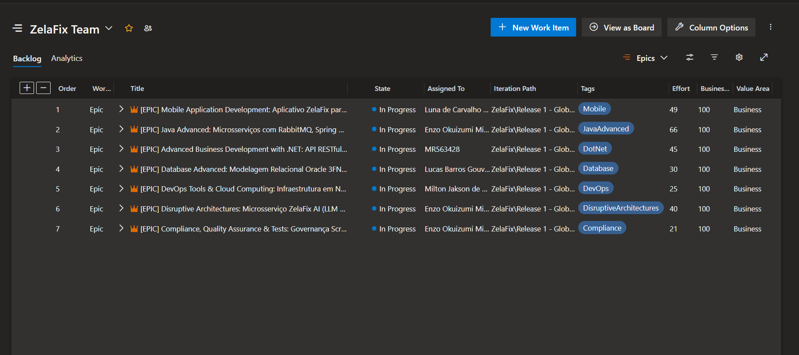
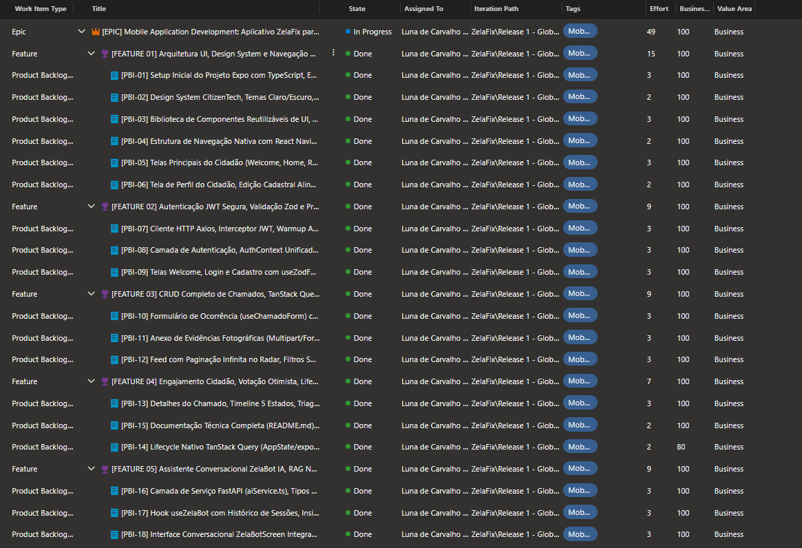
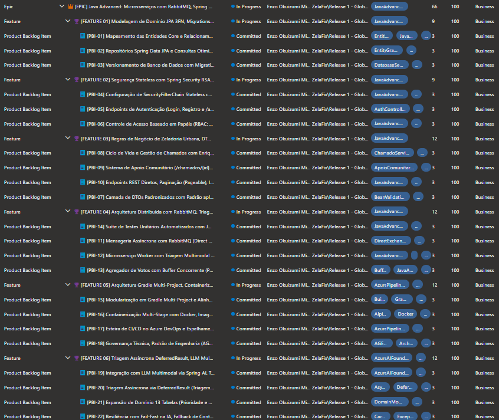
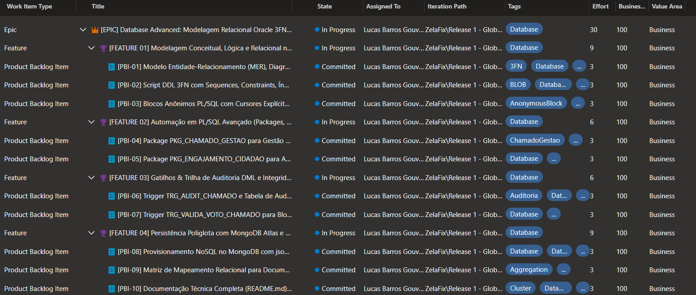
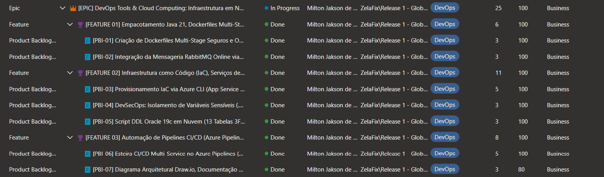
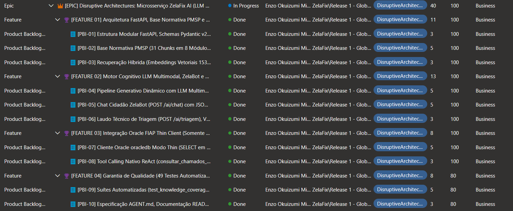
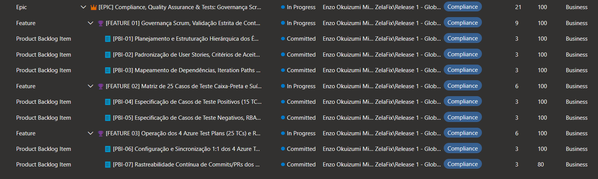

# 🏛️ CitizenTech (ZelaFix) — Compliance, Quality Assurance & Tests

> **FIAP Global Solution 2026/2 • Turmas de Fevereiro (2TDSPG)**  
> **Tema:** CitizenTech — Zeladoria Urbana Colaborativa (ODS 11 – Cidades e Comunidades Sustentáveis)  
> **Disciplina:** Compliance, Quality Assurance & Tests  
> **Plataforma Oficial:** Microsoft Azure DevOps — [`ZelaFixGS/ZelaFix`](https://dev.azure.com/ZelaFixGS/ZelaFix) (Azure Boards, Azure Repos & Azure Test Plans)

---

## 👥 Integrantes do Grupo (Ordem Alfabética Estrita)

| Nome Completo | RM | Turma | GitHub | LinkedIn |
| :--- | :---: | :---: | :--- | :--- |
| **Enzo Okuizumi Miranda de Souza** | **561432** | 2TDSPG | [@EnzoOkuizumiFiap](https://github.com/EnzoOkuizumiFiap) | [LinkedIn](https://www.linkedin.com/in/enzo-okuizumi-b60292256/) |
| **Gustavo Keiji Okada** | **563428** | 2TDSPG | [@Gdev3356](https://github.com/Gdev3356) | [LinkedIn](https://www.linkedin.com/in/gustavo-okada-53a3b8359/) |
| **Lucas Barros Gouveia** | **566422** | 2TDSPG | [@LuzBGouveia](https://github.com/LuzBGouveia) | [LinkedIn](https://www.linkedin.com/in/lucas-barros-gouveia-09b147355/) |
| **Luna de Carvalho Guimarães** | **562290** | 2TDSPG | [@lunaguima](https://github.com/lunaguima) | [LinkedIn](https://www.linkedin.com/in/luna-guimar%C3%A3es-b0ba82309/) |
| **Milton Jakson de Sousa Marcelino** | **564836** | 2TDSPG | [@MiltonMarcelino](https://github.com/MiltonMarcelino) | [LinkedIn](https://www.linkedin.com/in/milton-marcelino-250298142) |

---

## 🔗 Links Oficiais de Entrega (Global Solution 2)

| Recurso | Descrição | Link Oficial |
| :--- | :--- | :--- |
| 📋 **Azure Boards & Test Plans (QA)** | Backlogs Scrum, Rastreabilidade e 25 Casos de Teste (`ZelaFixGS/ZelaFix`) | https://dev.azure.com/ZelaFixGS/ZelaFix |
| 📄 **Documentação Compliance (PDF)** | Relatório oficial consolidado com prints do Azure Boards, Test Plans, Test Cases e Progress Report | [Documentação Compliance GS 2 - ZelaFix.pdf](./docs/Documenta%C3%A7%C3%A3o%20Compliance%20GS%202%20-%20ZelaFix.pdf) |
| 🐙 **Repositório Oficial (Compliance & QA)** | Governança, automação Python, matriz de testes e suíte Postman | https://github.com/Global-Solution-CitizenTech/Compliance-Quality-Assurance-Tests |
| ☕ **Repositório Java (GitHub + Azure Repos)** | Microsserviços Spring Boot (`zelafix-api` e `zelafix-worker`), Flyway, Docker e CI/CD | https://github.com/Global-Solution-CitizenTech/Java-Advanced |

---

## 🌐 Links do Ecossistema Integrado em Produção

| Componente | Descrição | Link |
| :--- | :--- | :--- |
| 🌐 **API REST Java (Azure Web App)** | Gateway Spring Boot (`zelafix-api`) com JWT RSA, `DeferredResult` e Oracle 19c | https://app-zelafix.azurewebsites.net |
| ⚙️ **Worker IA em Produção (Azure Web App)** | Worker stateless (`zelafix-worker`) com RabbitMQ e Spring AI (LLM Multimodal + Tool Calling) | https://app-zelafix-worker.azurewebsites.net |
| 🤖 **ZelaBot AI (Render Cloud)** | Microsserviço FastAPI com RAG ChromaDB (31 chunks PMSP), SQLite WAL e Oracle Thin Client | https://disruptive-architectures-iot-iob-ia-mpl5.onrender.com/ |
| 📖 **Swagger UI Interativo (OpenAPI 3.0)** | Documentação de endpoints (`Autenticação`, `Usuarios`, `Chamados`, `Históricos`, `Endereco`) | https://app-zelafix.azurewebsites.net/swagger-ui.html |
| 🩺 **Actuator Health (API & Worker)** | Healthcheck em tempo real (Oracle + CloudAMQP + Liveness/Readiness) | https://app-zelafix.azurewebsites.net/actuator/health |
| 🚀 **Repositório DevOps & Cloud** | IaC Azure CLI, Dockerfiles multi-stage, `azure-pipelines.yml` (211 testes) e DDL Oracle | https://github.com/Global-Solution-CitizenTech/DevOps-Tools-Cloud-Computing |

---

## 🔗 Repositórios Oficiais do Ecossistema CitizenTech

| Disciplina | Repositório no GitHub |
| :--- | :--- |
| 📱 **Mobile Application Development** | [Global-Solution-CitizenTech/Mobile-Application-Development](https://github.com/Global-Solution-CitizenTech/Mobile-Application-Development) |
| ☕ **Java Advanced** | [Global-Solution-CitizenTech/Java-Advanced](https://github.com/Global-Solution-CitizenTech/Java-Advanced) |
| 🗄️ **Database Advanced** | [Global-Solution-CitizenTech/Database-Advanced](https://github.com/Global-Solution-CitizenTech/Database-Advanced) |
| 🔷 **Advanced Business Development with .NET** | [Global-Solution-CitizenTech/Advanced-Business-Development-with-Dot-Net](https://github.com/Global-Solution-CitizenTech/Advanced-Business-Development-with-Dot-Net) |
| 🚀 **DevOps Tools & Cloud Computing** | [Global-Solution-CitizenTech/DevOps-Tools-Cloud-Computing](https://github.com/Global-Solution-CitizenTech/DevOps-Tools-Cloud-Computing) |
| 🤖 **Disruptive Architectures (IoT, IoB & IA)** | [Global-Solution-CitizenTech/Disruptive-Architectures-IoT-IoB-IA](https://github.com/Global-Solution-CitizenTech/Disruptive-Architectures-IoT-IoB-IA) |
| 🛡️ **Compliance, QA & Tests (ATUAL)** | [Global-Solution-CitizenTech/Compliance-Quality-Assurance-Tests](https://github.com/Global-Solution-CitizenTech/Compliance-Quality-Assurance-Tests) |

---

## 📊 Governança Consolidada no Azure Boards (`ZelaFixGS/ZelaFix`)

Todos os backlogs das 7 disciplinas estão centralizados em [`automatizar-boards/backlog-materias/`](./automatizar-boards/backlog-materias/), validados contra contrato mínimo obrigatório (`run_sync.py --validate`), atribuídos aos respectivos responsáveis, organizados por iteração (`Release 1 - Global Solution\Semana 1` e `Semana 2`) e sem tags redundantes:

| Disciplina | Iteration Path | Tag | Responsável | Epic ID | Features | PBIs | Story Points | Entregas Técnicas & Rastreabilidade |
| :--- | :--- | :--- | :--- | :---: | :---: | :---: | :---: | :--- |
| 📱 **Mobile Application Development** | `Semana 1` | `Mobile` | Luna de Carvalho Guimarães | `#1` | **5** | **18** | **49 SP** | **64 commits** vinculados; Expo SDK 58, `POST /chamados` direto via `DeferredResult` (sem polling), paginação infinita no Radar, `expo-network`, 78 testes unitários Node (`35` suítes), declaração de IA e APK `versionCode 14` (EAS `8c21e8d0`) |
| ☕ **Java Advanced** | `Semana 1` | `JavaAdvanced` | Enzo Okuizumi Miranda de Souza | `#14` | **6** | **22** | **66 SP** | **120+ commits** + PRs (`#1..#46`); Gradle Multi-Project, Docker multi-stage non-root, `azure-pipelines.yml`, espelhamento `mirror-to-azure.yml`, `DeferredResult` (`90s`), recusa IA sem Oracle, `TriagemNormativaTools` (`EnumMap`), Fail-Fast, Hikari/LOB tuning & 229 testes |
| 🗄️ **Database Advanced** | `Semana 1` | `Database` | Lucas Barros Gouveia | `#36` | **4** | **10** | **30 SP** | **25 commits** vinculados; **13 tabelas 3FN** Oracle + `auditoria_dml_chamado`, **5 ENUMs** alinhados ao Java, PL/SQL (`PRAGMA UDF`, JSON manual `CLOB`, subtotais manuais), MongoDB (`2` coleções `$jsonSchema`, `13` docs) |
| 🔷 **Advanced Business Dev. with .NET** | `Semana 2` | `DotNet` | Gustavo Keiji Okada | `#27` | **5** | **15** | **45 SP** | Web API **.NET 10** Clean Architecture, EF Core Oracle 19c, Swagger 23 paths, OpenTelemetry/Prometheus, Serilog, Health Checks e **106 testes xUnit/Moq (>91% cobertura)** |
| 🚀 **DevOps Tools & Cloud Computing** | `Semana 2` | `DevOps` | Milton Jakson de Sousa Marcelino | `#48` | **3** | **7** | **25 SP** | **34 commits** vinculados; Dockerfiles multi-stage Java 21, CloudAMQP TLS, IaC `script-provisionamento.sh` (App Service Plan `F1`, Web Apps API/Worker, Provedor de LLM Multimodal), DDL 13 tabelas (`script-bd.sql`), `azure-pipelines.yml` (**211 testes JUnit 5**) e diagrama Draw.io |
| 🤖 **Disruptive Architectures (IoT, IoB & IA)** | `Semana 2` | `DisruptiveArchitectures` | Enzo Okuizumi Miranda de Souza | `#58` | **4** | **10** | **40 SP** | **44 commits**; FastAPI ZelaBot AI no Render, Provedor de LLM Multimodal (Embeddings + fallback resiliente), ChromaDB (`31` chunks / `8` módulos), SQLite WAL, Oracle Thin Client + Tool Calling ReAct e `49` testes automatizados |
| 🛡️ **Compliance, QA & Tests** | `Semana 2` | `Compliance` | Enzo Okuizumi Miranda de Souza | `#67` | **3** | **7** | **21 SP** | **26+ commits** vinculados; governança Scrum (`7` Epics, `30` Features, `89` PBIs com `Acceptance Criteria`), validação automática (`parser_backlog.py`), suíte Postman (`57` requests), Azure Test Plans (`25` Test Cases — 100% `Passed`) e PDF oficial (`17` págs.) |
| **TOTAL CONSOLIDADO (7 Disciplinas)** | **2 Sprints** | **7 Tags** | **5 Integrantes** | **7 Epics** | **30** | **89** | **276 SP** | **126 Work Items de Backlog** + **4 Test Plans, 4 Test Suites e 25 Test Cases (`25/25 Passed`)** no Azure DevOps |

---

## 🖼️ Evidências Visuais dos Boards

As capturas de tela oficiais dos Boards no Azure DevOps (`ZelaFixGS/ZelaFix`) estão versionadas no diretório [`docs/`](./docs/), comprovando a hierarquia **Epic → Feature → PBI**, os estados de execução, os responsáveis, as Iteration Paths (`Semana 1` / `Semana 2`), as tags por disciplina e o esforço em Story Points.

### 📊 Visão Consolidada — 7 Épicos



### 📱 Mobile Application Development



### ☕ Java Advanced



### 🗄️ Database Advanced



### 🔷 Advanced Business Development with .NET


### 🚀 DevOps Tools & Cloud Computing



### 🤖 Disruptive Architectures (IoT, IoB & IA)



### 🛡️ Compliance, Quality Assurance & Tests



---

## 📂 Estrutura de Diretórios de Compliance & QA

```text
Compliance-Quality-Assurance-Tests/
│
├── automatizar-boards/
│   ├── backlog-materias/                      # Backlogs centralizados das 7 disciplinas
│   │   ├── BACKLOG_COMPLIANCE.md
│   │   ├── BACKLOG_MOBILE.md
│   │   ├── BACKLOG_JAVA_ADVANCED.md
│   │   ├── BACKLOG_DATABASE_ADVANCED.md
│   │   ├── BACKLOG_DOT_NET.md
│   │   ├── BACKLOG_DEVOPS.md
│   │   └── BACKLOG_DISRUPTIVE_ARCHITECTURES.md
│   ├── run_sync.py                            # CLI unificada (--update, --validate, --all, --discipline, --commits, --govern, --hooks, --status, --full)
│   ├── sync_engine.py                         # Motor central SyncEngine (Smart Upsert, rastreamento de commits, governança e validação)
│   ├── parser_backlog.py                      # Parser Markdown + extração de IDs Azure + validação estrita de contrato (BacklogValidationError)
│   ├── azure_client.py                        # Cliente HTTP REST oficial para Azure DevOps (WIQL, CRUD, vínculos, ArtifactLink)
│   ├── config.py                              # Configurações ZelaFixGS/ZelaFix, integrantes, tags e Iteration Paths
│   ├── install_git_hooks.py                   # Instalador de hooks post-commit nos 7 repositórios locais
│   ├── INSTRUCOES_AUTOMACAO_AZURE_BOARDS.md   # Guia arquitetural da automação
│   ├── requirements.txt                       # Dependências Python
│   └── .env.example                           # Modelo de configuração de PAT e organização
│
├── docs/
│   ├── Documentação Compliance GS 2 - ZelaFix.pdf # Relatório oficial consolidado (Boards + Test Plans + Progress Report)
│   ├── MATRIZ_CASOS_DE_TESTE_AZURE.md         # Matriz completa dos 25 Casos de Teste sincronizados com o Azure Test Plans
│   ├── Todos-Epics.png                        # Evidência visual: visão consolidada dos 7 Épicos
│   ├── Mobile.png                             # Evidência visual: Board Mobile
│   ├── Java.png                               # Evidência visual: Board Java Advanced
│   ├── Database.png                           # Evidência visual: Board Database Advanced
│   ├── Dot Net.png                            # Evidência visual: Board .NET
│   ├── DevOps.png                             # Evidência visual: Board DevOps & Cloud
│   ├── DisruptiveArch.png                     # Evidência visual: Board Disruptive Architectures
│   └── Compliance.png                         # Evidência visual: Board Compliance & QA
│
├── postman/
│   ├── CitizenTech_QA_Automation.postman_collection.json   # Suíte E2E automatizada (6 pastas, 57 requests, 57 scripts pm.test())
│   └── CitizenTech_QA_Environment.postman_environment.json # Variáveis de ambiente Local e Cloud (25 variáveis)
│
├── identificacao.txt                          # Identificação institucional obrigatória (RM, Nome, Turma)
└── README.md                                  # Documentação principal
```

---

## 🚀 Como Executar a Automação Python & Validação de Backlogs

### 1. Pré-requisitos e Configuração
- Python 3.10 ou superior (`pip install -r automatizar-boards/requirements.txt`)
- Personal Access Token (PAT) no Azure DevOps (`ZelaFixGS/ZelaFix`) com escopos `Work Items (Read & Write)` e `Test Management (Read & Write)`

Configure o arquivo `automatizar-boards/.env` (baseado em [`automatizar-boards/.env.example`](./automatizar-boards/.env.example)):
```ini
AZURE_DEVOPS_ORG=ZelaFixGS
AZURE_DEVOPS_PROJECT=ZelaFix
AZURE_DEVOPS_PAT=seu_pat_aqui
GITHUB_ORG=Global-Solution-CitizenTech
```

### 2. Validação Obrigatória de Contrato (`parser_backlog.py` + `run_sync.py --validate`)
O parser [`parser_backlog.py`](./automatizar-boards/parser_backlog.py) implementa `validate_backlog_document()` e `BacklogValidationError` (executado em modo `strict=True` durante a sincronização e localmente via `--validate`), garantindo que nenhum Epic, Feature ou PBI perca metadados obrigatórios:
- `Start Date` e `Target Date` válidos e coerentes (`Start Date <= Target Date`)
- `Tags` obrigatórias por disciplina (com validação estrita `exact_tag_only` para todas as 7 disciplinas)
- `Effort (Story Points) > 0`, `Priority` válida (`1` a `4`) e `Business Value > 0`
- `Description` (História de Usuário) e `Acceptance Criteria` preenchidos

```bash
cd automatizar-boards

# Validar localmente os 7 arquivos de backlog antes de qualquer sincronização:
python run_sync.py --validate
```

### 3. Comandos Principais do Orquestrador (`run_sync.py`)
```bash
# Verificar conexão e permissões no Azure DevOps:
python run_sync.py --check-auth

# Exibir painel consolidado de saúde dos Work Items no Azure Boards:
python run_sync.py --status

# 🔄 Smart Upsert: Atualizar Backlog(s) sem duplicar itens existentes:
python run_sync.py --update --dry-run             # Simula a atualização de todas as disciplinas
python run_sync.py --update                       # Atualiza todos os 7 backlogs no Azure Boards
python run_sync.py --update --discipline java     # Atualiza somente Java
python run_sync.py --update --discipline mobile   # Atualiza somente Mobile
python run_sync.py --update --discipline database # Atualiza somente Database

# Carga inicial do zero (apenas para novas implantações):
python run_sync.py --all --dry-run
python run_sync.py --all
python run_sync.py --discipline <materia>

# Escanear os 7 repositórios e vincular commits aos Work Items:
python run_sync.py --commits

# Aplicar governança de responsáveis e estados (Epics: In Progress | Features e PBIs: Done):
python run_sync.py --govern

# Instalar post-commit hooks automáticos (tag AB#<ID>) nos 7 repositórios:
python run_sync.py --hooks

# Executar pipeline completo (carga + commits + governança):
python run_sync.py --full
```

---

## 📮 Suíte Automatizada Postman (`postman/`)

A coleção oficial de testes de API está disponível em [`postman/CitizenTech_QA_Automation.postman_collection.json`](./postman/CitizenTech_QA_Automation.postman_collection.json) acompanhada do ambiente [`postman/CitizenTech_QA_Environment.postman_environment.json`](./postman/CitizenTech_QA_Environment.postman_environment.json):

- **Escopo:** **6 pastas**, **57 requests** e **57 scripts de asserção (`99` testes `pm.test()`)** com **25 variáveis de ambiente** (suportando ambiente Local `http://localhost:8080` / `8081` e Cloud Azure `https://app-zelafix.azurewebsites.net` / `https://app-zelafix-worker.azurewebsites.net`).
- **Pastas da Coleção:**
  1. `01. Observabilidade, Actuator & OpenAPI` (**4 requests**): `/actuator/health` (API e Worker), `/actuator/info` e `/v3/api-docs`.
  2. `02. Autenticação & RBAC` (**9 requests**): `POST /login` para `ADMIN`, `GESTOR` e `CIDADAO` (seeds Flyway V2/V3), rejeições `401`/`400` (`erros[]`) e bloqueio `403` em `/actuator/metrics` para `CIDADAO`.
  3. `03. Usuários (/usuarios)` (**14 requests**): `POST /usuarios` (`201`, `409` duplicado, `400` Bean Validation/`@DddValidation`), `GET /usuarios/me`, `PUT /usuarios/me` (com header `X-Novo-Token`), gestão ADMIN (`GET /usuarios`, `GET /usuarios/{id}`, `GET /usuarios/by-email`, `PUT /usuarios/{id}`, `PATCH /usuarios/{id}/cargo`).
  4. `04. Endereços (/enderecos — ADMIN only)` (**8 requests**): CRUD completo em `/enderecos` restrito a `ROLE_ADMIN`, normalização de CEP e resolução ViaCEP.
  5. `05. Chamados, Triagem IA (DeferredResult) & Apoio` (**16 requests**): `POST /chamados` exclusivamente `multipart/form-data` (`cep`, `numero`, `referencia`, `rua?` + `foto`) via `DeferredResult` (`90s` -> `201 Created` em `EM_ANALISE` ou `PENDENTE`, `400 Bad Request` para magic bytes inválidos ou recusa da IA `ocorrenciaValida=false` sem persistir no Oracle), `GET /chamados` paginado com filtros dinâmicos, `GET /chamados/{id}/foto` público, `PUT /chamados/{id}`, `PATCH /chamados/{id}/status` (`{status, observacao}` para `EM_EXECUCAO`/`CONCLUIDO`), `POST /chamados/{id}/apoiar` (toggle ON/OFF) e `GET /chamados/estatisticas`.
  6. `06. Teardown & Limpeza` (**6 requests**): validações de exclusão (`DELETE /chamados/{id}` -> `403` CIDADAO / `204` GESTOR ou ADMIN -> `404`), `DELETE /usuarios/me` e `DELETE /usuarios/{id}`.

---

## 🧪 Casos de Teste Funcionais (Azure Test Plans)

Os **25 casos de teste** ativos (`15` Positivos e `10` Negativos, estado `Ready`, Iteration `ZelaFix\Release 1 - Global Solution\Semana 2`, owner `Enzo Okuizumi Miranda de Souza`) estão cadastrados no **Azure DevOps (`ZelaFixGS/ZelaFix`)** em **4 Test Plans / 4 Test Suites** (`#132`/`#133`, `#143`/`#144`, `#153`/`#154`, `#122`/`#123`) com paridade 1:1 em relação à coleção Postman, à API/Worker Java, ao modelo Oracle/MongoDB (**13 tabelas** e **5 ENUMs**) e ao microsserviço **ZelaBot AI**:

| Código | Azure ID | Caso de Teste | Test Suite | Tipo |
| :---: | :---: | :--- | :--- | :---: |
| **TC-01** | `#134` | Autenticar contas de QA (ADMIN, GESTOR e CIDADAO) e validar `GET /usuarios/me` | `api-auth-rbac` | Positivo |
| **TC-02** | `#137` | Rejeitar login com credenciais inválidas ou payload malformado | `api-auth-rbac` | Negativo |
| **TC-03** | `#139` | Bloquear endpoints protegidos sem token Bearer | `api-auth-rbac` | Negativo |
| **TC-04** | `#140` | Rejeitar token JWT inválido ou assinatura adulterada | `api-auth-rbac` | Negativo |
| **TC-05** | `#141` | Bloquear acesso de CIDADAO a endpoints administrativos (RBAC) | `api-auth-rbac` | Negativo |
| **TC-06** | `#142` | Impedir CIDADAO de alterar status, editar ou excluir chamado (RBAC GESTOR/ADMIN) | `api-auth-rbac` | Negativo |
| **TC-07** | `#145` | Cadastrar novo cidadão (`POST /usuarios`) e atualizar perfil (`/usuarios/me`) | `api-usuarios-enderecos` | Positivo |
| **TC-08** | `#147` | Rejeitar cadastro com e-mail duplicado (`409`) ou dados inválidos (`400`) | `api-usuarios-enderecos` | Negativo |
| **TC-09** | `#148` | Gerenciar usuários como ADMIN (listar, by-email, `PATCH` cargo e `DELETE`) | `api-usuarios-enderecos` | Positivo |
| **TC-10** | `#149` | Criar, listar, atualizar e excluir endereço como ADMIN com ViaCEP | `api-usuarios-enderecos` | Positivo |
| **TC-11** | `#151` | Rejeitar criação de endereço com CEP ou campos obrigatórios inválidos | `api-usuarios-enderecos` | Negativo |
| **TC-12** | `#152` | Validar observabilidade (`/actuator/health`, `/v3/api-docs`) e `404` para IDs inexistentes | `api-usuarios-enderecos` | Positivo |
| **TC-13** | `#155` | Abrir chamado `multipart/form-data` via `DeferredResult` e triagem IA (`POST /chamados`) | `api-chamados` | Positivo |
| **TC-14** | `#156` | Recuperar foto BLOB do chamado com MIME dinâmico (`GET /chamados/{id}/foto`) | `api-chamados` | Positivo |
| **TC-15** | `#158` | Rejeitar abertura de chamado com part `foto` ausente, arquivo inválido ou endereço inválido | `api-chamados` | Negativo |
| **TC-16** | `#161` | Consultar chamados paginados com filtros dinâmicos e painel de estatísticas | `api-chamados` | Positivo |
| **TC-17** | `#163` | Atualizar chamado, alternar apoio comunitário e evoluir status com histórico | `api-chamados` | Positivo |
| **TC-18** | `#166` | Excluir chamado como GESTOR ou ADMIN e confirmar remoção em cascata (`404`) | `api-chamados` | Positivo |
| **TC-19** | `#124` | Confirmar triagem assíncrona do Worker Spring AI com Tools normativas e SLA | `ai-service` | Positivo |
| **TC-20** | `#126` | Recusar imagem fora de escopo na triagem IA sem persistir chamado no Oracle | `ai-service` | Negativo |
| **TC-21** | `#127` | Responder consulta ZelaBot com RAG normativo (ChromaDB) e higienização mobile | `ai-service` | Positivo |
| **TC-22** | `#128` | Acionar guardrail de risco vital no ZelaBot (Defesa Civil / Bombeiros / ENEL) | `ai-service` | Positivo |
| **TC-23** | `#129` | Manter escopo cívico do ZelaBot diante de solicitação fora de domínio | `ai-service` | Negativo |
| **TC-24** | `#131` | Gerar laudo técnico estruturado (`POST /ai/triagem`) e insights preventivos (`/ai/insights`) | `ai-service` | Positivo |
| **TC-25** | `#197` | Validar observabilidade, sessões SQLite e leitura Oracle no ZelaBot AI | `ai-service` | Positivo |

Consulte a [matriz completa de casos de teste](./docs/MATRIZ_CASOS_DE_TESTE_AZURE.md) para pré-condições, payloads, códigos HTTP e passos XML (`Microsoft.VSTS.TCM.Steps`) cadastrados no Azure DevOps.

---

## 🤖 Declaração de Uso de Inteligência Artificial Generativa

Em cumprimento às diretrizes da Global Solution FIAP:

* **Ferramentas Utilizadas:** **Gemini 3.8 Flash**, **Gemini 4 Hydrogen** e **Claude Sonnet 5.5**.
* **Finalidade de Uso:** Apoio na estruturação de scripts Python de sincronização REST com o Azure DevOps (`SyncEngine` e `AzureClient`), revisão de asserções JavaScript `pm.test()` na coleção Postman e revisão textual da documentação e matriz de casos de teste.
* **Revisão Humana:** Todo o planejamento Scrum (Epics, Features e PBIs), critérios de aceite, modelagem de 25 casos de teste caixa-preta (positivos e negativos), execução no Azure Test Plans e homologação E2E foram projetados, executados e auditados pelos integrantes do grupo.

